# 🏷️ Portfólio Profissional — Beatriz Almeida Andrade 👩‍💻

Website de portfólio profissional desenvolvido em **React + Vite** para apresentar minha trajetória, habilidades, projetos e formas de contato de maneira moderna e acessível. O site é **bilíngue (português e inglês)**, **responsivo** e está **hospedado gratuitamente na Vercel**.

<table>
  <tr>
    <td width="800px">
      <div align="justify">
        Este projeto foi desenvolvido para a disciplina de <b>Desenvolvimento e Integração de Aplicações Web</b> do curso de <b>Engenharia de Software da PUC Minas</b>. O portfólio reúne a seção <b>Sobre Mim</b> em dois idiomas, uma <b>linha do tempo de projetos</b> com GIFs e apps que podem ser testados dentro do próprio site, as <b>experiências</b> (incluindo o Prêmio Stellantis de Educação e certificados) e uma página de <b>contato</b> com formulário que envia e-mail de verdade. A identidade visual é escura, com fundo estrelado animado e um crachá interativo com a minha foto.
      </div>
    </td>
    <td>
      <div>
        
      </div>
    </td>
  </tr>
</table>

---

## 🚧 Status do Projeto


---

## 📚 Índice
- [Links Úteis](#-links-úteis)
- [Sobre o Projeto](#-sobre-o-projeto)
- [Funcionalidades Principais](#-funcionalidades-principais)
- [Tecnologias Utilizadas](#-tecnologias-utilizadas)
- [Arquitetura](#-arquitetura)
- [Instalação e Execução](#-instalação-e-execução)
- [Deploy](#-deploy)
- [Estrutura de Pastas](#-estrutura-de-pastas)
- [Demonstração](#-demonstração)
- [Testes](#-testes)
- [Documentações utilizadas](#-documentações-utilizadas)
- [Autores](#-autores)
- [Contribuição](#-contribuição)
- [Agradecimentos](#-agradecimentos)
- [Licença](#-licença)

---

## 🔗 Links Úteis

* 🌐 **Site publicado (Vercel):** https://portfolio-profissional-six-phi.vercel.app
* 🎨 **Wireframes no Figma (média fidelidade):** https://www.figma.com/design/X7S6ppMXEHrzhjD9YpMLmP
* 📁 **Repositório:** https://github.com/beatrizaandradee/Portf-lio-Profissional

---

## 📝 Sobre o Projeto

**Por que o projeto existe:** para ter um site profissional próprio, que reúne num só lugar quem eu sou, o que eu já construí e como falar comigo. Ele serve para recrutadores, professores e qualquer pessoa que queira conhecer meu trabalho.

**Problema que resolve:** um currículo em PDF não mostra o que um desenvolvedor sabe fazer. No portfólio, quem visita **vê os projetos funcionando** (GIFs e o botão "Testar aqui"), lê minha trajetória em português ou inglês e entra em contato direto pelo formulário.

**Contexto:** projeto da disciplina de Desenvolvimento e Integração de Aplicações Web, seguindo a descrição do Product Owner: seções Sobre Mim, Projetos, Experiências e Contato acessadas por um menu, design responsivo, hospedagem gratuita em nuvem e README completo.

**Casos de uso:**
- Um recrutador abre o link, troca para inglês e testa um projeto sem instalar nada.
- O professor confere a linha do tempo de projetos e os repositórios no GitHub.
- Alguém interessado envia uma mensagem pelo formulário e ela chega no meu e-mail.

---

## ✨ Funcionalidades Principais

- 🌐 **Bilíngue (PT/EN):** botão no menu que troca o idioma do site inteiro; começa no idioma do navegador e lembra a escolha.
- 🧭 **Menu de navegação:** fixo, destaca a seção atual e vira menu hambúrguer no celular.
- 👩‍💻 **Sobre Mim:** formação (PUC Minas, SESI Betim, Colégio Educare), área de atuação, interesses, objetivos e tecnologias.
- 🕒 **Linha do tempo de projetos:** ordenada automaticamente do mais antigo para o mais recente, com nome, descrição, tecnologias, link do GitHub e **GIF do projeto em funcionamento**.
- ▶️ **"Testar aqui":** cada projeto abre funcionando numa janela dentro do portfólio.
- 🧩 **Mini Projetos:** calculadora, lista de tarefas, gerador de senhas, jogo da velha (algoritmo Minimax) e pomodoro.
- 💼 **Experiências:** instituição, atividade, período e descrição de cada item.
- 🏆 **Conquistas:** Prêmio Stellantis de Educação e galeria de certificados que abrem o PDF original.
- 📬 **Contato:** ícones clicáveis (e-mail, WhatsApp, LinkedIn, GitHub, Instagram) e formulário com **validação** e **envio real por e-mail**, com proteção anti-spam.
- 📱 **Responsivo e acessível:** funciona do celular ao monitor, com navegação por teclado, textos alternativos e respeito à opção "reduzir movimento".

### Projetos da linha do tempo

| Projeto | Tecnologias | Testar |
|---|---|---|
| **Mini Projetos**: calculadora, lista de tarefas, gerador de senhas, jogo da velha e pomodoro | HTML, CSS, JavaScript | [abrir](https://portfolio-profissional-six-phi.vercel.app/mini-projetos/) |
| **Análise de Gastos**: lê o extrato bancário em CSV e gera relatório com gráficos | Python, pandas, matplotlib | [ver relatório](https://portfolio-profissional-six-phi.vercel.app/apps/analise-gastos/) |
| **Simulador de Investimentos**: Poupança x Tesouro x CDB x LCI/LCA com IR e inflação | JavaScript, Canvas | [abrir](https://portfolio-profissional-six-phi.vercel.app/apps/simulador-investimentos/) |
| **Finanças+**: controle financeiro com dashboard, orçamentos e metas | React, Vite, SVG | [abrir](https://portfolio-profissional-six-phi.vercel.app/apps/financas-app/) |
| **Vitrine**: e-commerce completo com carrinho, cupons, frete e checkout validado | React, Context API | [abrir](https://portfolio-profissional-six-phi.vercel.app/apps/vitrine-ecommerce/) |
| **Rota**: app de mobilidade (estilo Uber) com mapa, preços e corrida ao vivo | React, SVG | [abrir](https://portfolio-profissional-six-phi.vercel.app/apps/rota-app/) |
| **Ritmo**: app de corrida com GPS, pace, parciais e metas | React, Geolocation API | [abrir](https://portfolio-profissional-six-phi.vercel.app/apps/ritmo-corrida/) |
| **Lumi**: plataforma de streaming com perfis, recomendações e player | React, Canvas, SVG | [abrir](https://portfolio-profissional-six-phi.vercel.app/apps/lumi-streaming/) |

---

## 🛠 Tecnologias Utilizadas

### 💻 Front-end

* **Biblioteca:** React 19 (componentes, hooks e Context API)
* **Build e servidor de desenvolvimento:** Vite 7
* **Linguagem:** JavaScript (ES2022) com JSX
* **Estilização:** CSS3 puro (variáveis CSS, Grid, Flexbox, media queries e animações)
* **Ícones:** react-icons
* **Gráficos e animações:** Canvas API (fundo de estrelas) e SVG
* **Fontes:** Inter e JetBrains Mono (Google Fonts)

### 🖥️ Back-end

* **Não há back-end próprio.** O formulário de contato usa o serviço **FormSubmit**, que recebe os dados do site e encaminha para o meu e-mail.

### ⚙️ Infraestrutura e DevOps

* **Hospedagem:** Vercel (plano gratuito)
* **CI/CD:** deploy automático da Vercel a cada `git push` na branch `main`
* **Versionamento:** Git e GitHub
* **Prototipação:** Figma (wireframes de média fidelidade)

### 📦 Dependências e bibliotecas

| Pacote | Versão | Tipo | Para que serve |
|---|---|---|---|
| `react` | ^19.2.0 | dependência | Construção da interface |
| `react-dom` | ^19.2.0 | dependência | Renderização do React no navegador |
| `react-icons` | ^5.5.0 | dependência | Ícones (Feather, Font Awesome e Simple Icons) |
| `vite` | ^7.1.0 | desenvolvimento | Servidor de desenvolvimento e build de produção |
| `@vitejs/plugin-react` | ^5.0.0 | desenvolvimento | Suporte a JSX e Fast Refresh no Vite |

---

## 🏗 Arquitetura

O site é uma **SPA (página única)** em React. A principal decisão foi **separar o conteúdo da interface**: textos, projetos e experiências ficam em arquivos de dados, e os componentes só leem esses dados e montam as telas.

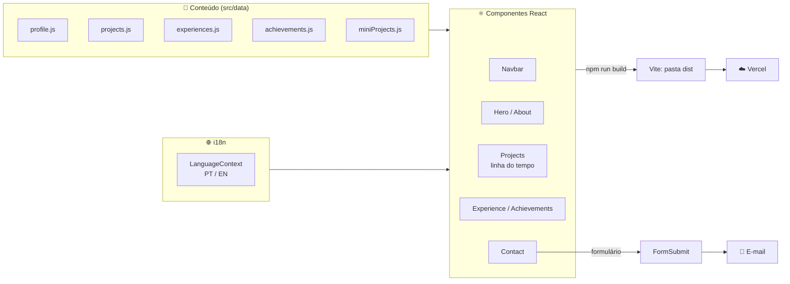

| Camada | Responsabilidade |
|---|---|
| **Conteúdo** (`src/data`) | Guarda todos os textos, projetos e experiências, com versão `pt` e `en`. Para atualizar o site, só esses arquivos mudam. |
| **Idioma** (`src/i18n`) | O `LanguageContext` (Context API) guarda o idioma escolhido e entrega os textos certos para todos os componentes. |
| **Interface** (`src/sections` e `src/components`) | Seções da página e componentes reutilizáveis (menu, crachá, fundo de estrelas, ícones). |
| **Envio de e-mail** | O formulário envia para o FormSubmit, que encaminha para o e-mail cadastrado. Sem servidor próprio. |
| **Build e hospedagem** | O Vite gera a pasta `dist`, publicada pela Vercel a cada push. |

---

## 🔧 Instalação e Execução

### Pré-requisitos

* **Node.js:** versão 20 ou superior
* **Gerenciador de pacotes:** npm (vem com o Node.js)
* **Git**

### Variáveis de ambiente

Este projeto **não precisa de variáveis de ambiente**. O e-mail que recebe as mensagens do formulário fica em `portfolio/src/data/profile.js` (`contact.email` e `formEndpoint`).

### Instalação das dependências

```bash
# 1. Clonar o repositório
git clone https://github.com/beatrizaandradee/Portf-lio-Profissional.git

# 2. Entrar na pasta do projeto
cd Portf-lio-Profissional/portfolio

# 3. Instalar as dependências
npm install
```

### Como executar a aplicação

```bash
npm run dev
```

Abra **http://localhost:5173** no navegador.

### Ativação do formulário de contato

Na primeira mensagem enviada pelo site publicado, o FormSubmit manda um e-mail de ativação para o endereço configurado. Depois de clicar em **Activate Form**, todas as mensagens chegam na caixa de entrada.

---

## 🚀 Deploy

O site está publicado em **https://portfolio-profissional-six-phi.vercel.app**.

### Build de produção

```bash
cd portfolio
npm run build     # gera a pasta dist/
npm run preview   # testa a versão de produção em http://localhost:4173
```

### Publicação na Vercel

1. Entre em [vercel.com](https://vercel.com) com a conta do GitHub.
2. **Add New → Project** e escolha este repositório.
3. Em **Root Directory**, selecione a pasta **`portfolio`**.
4. A Vercel detecta o Vite sozinha (Build: `npm run build` · Output: `dist`). Clique em **Deploy**.

A cada `git push` na branch `main`, a Vercel publica a nova versão automaticamente.

---

## 📂 Estrutura de Pastas

```
.
├── README.md                    # Este arquivo
├── LICENSE                      # Licença MIT
├── docs/                        # Imagens usadas neste README
└── portfolio/                   # Projeto React + Vite
    ├── public/                  # Arquivos estáticos (servidos como estão)
    │   ├── favicon.svg
    │   ├── foto.jpg             # Foto de perfil
    │   ├── img/                 # Foto da premiação
    │   ├── certificados/        # PDFs e miniaturas dos certificados
    │   ├── projects/            # GIFs e prints dos projetos
    │   ├── mini-projetos/       # 5 mini apps em JavaScript puro
    │   └── apps/                # Versões compiladas dos projetos ("Testar aqui")
    ├── src/
    │   ├── components/          # Componentes reutilizáveis
    │   │   ├── Avatar.jsx       # Foto com plano B de iniciais
    │   │   ├── Badge.jsx        # Crachá interativo
    │   │   ├── Footer.jsx       # Rodapé
    │   │   ├── Loader.jsx       # Tela de carregamento (%)
    │   │   ├── Navbar.jsx       # Menu e troca de idioma
    │   │   ├── Reveal.jsx       # Animação ao rolar
    │   │   ├── SocialLinks.jsx  # Ícones de contato
    │   │   ├── Starfield.jsx    # Fundo de estrelas (canvas)
    │   │   └── TechIcon.jsx     # Ícones das tecnologias
    │   ├── data/                # ⭐ Conteúdo do site
    │   │   ├── profile.js       # Dados pessoais, Sobre Mim e contatos
    │   │   ├── projects.js      # Projetos da linha do tempo
    │   │   ├── miniProjects.js  # Mini projetos
    │   │   ├── experiences.js   # Experiências
    │   │   └── achievements.js  # Prêmio e certificados
    │   ├── i18n/                # Português e inglês
    │   │   ├── LanguageContext.jsx
    │   │   └── translations.js
    │   ├── sections/            # Seções da página
    │   │   ├── Hero.jsx
    │   │   ├── About.jsx
    │   │   ├── Projects.jsx
    │   │   ├── Experience.jsx
    │   │   ├── Achievements.jsx
    │   │   └── Contact.jsx
    │   ├── styles/global.css    # Estilos e identidade visual
    │   ├── App.jsx              # Monta as seções
    │   └── main.jsx             # Ponto de entrada
    ├── index.html
    ├── package.json
    ├── vercel.json
    └── vite.config.js
```

---

## 🎥 Demonstração

### 🎨 Wireframes (Figma)

| Início | Projetos | Contato | Celular |
|---|---|---|---|
| 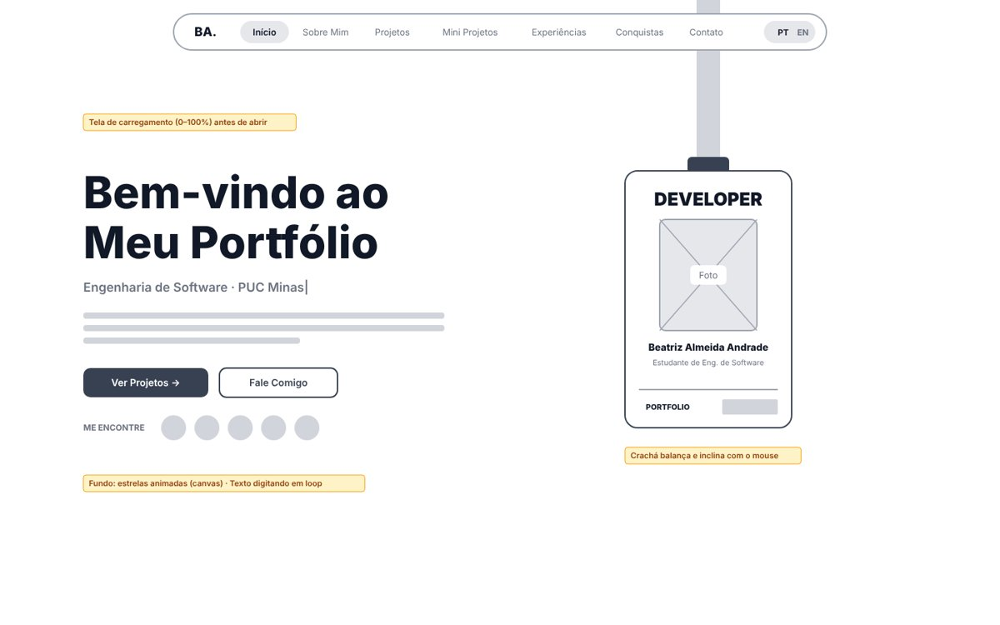 | 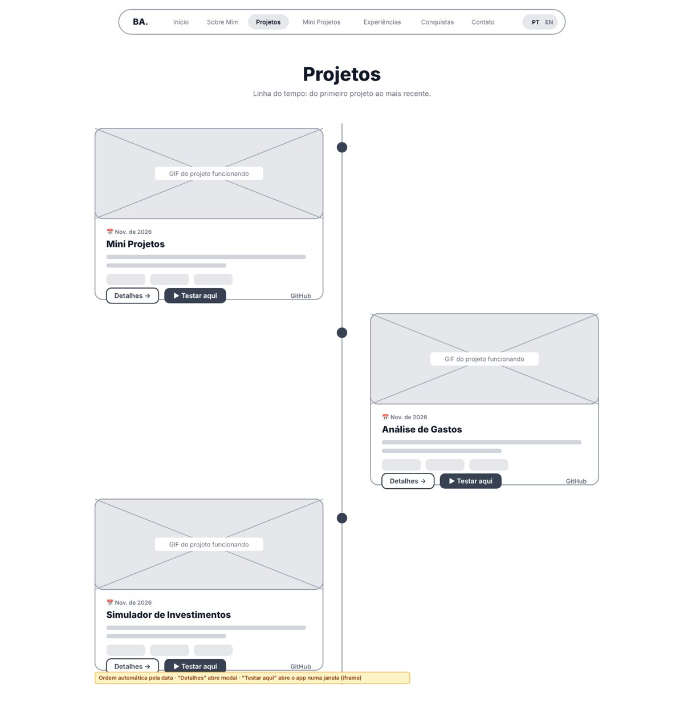 | 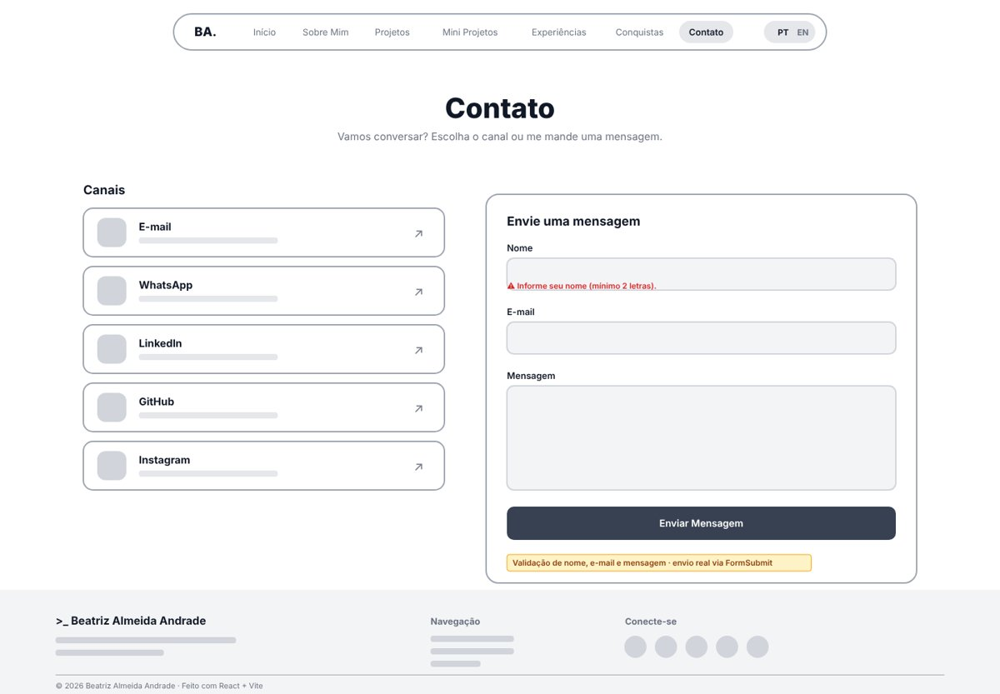 | 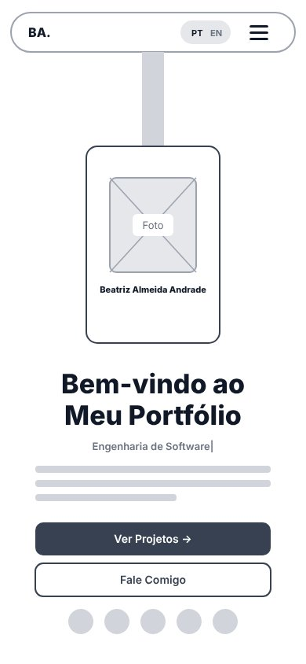 |

### 🌐 Aplicação Web

**Início:** tela de entrada com crachá interativo e texto digitando

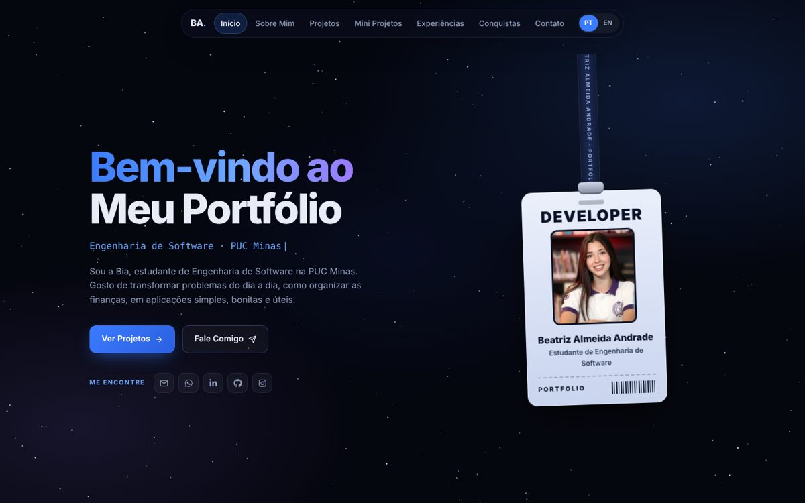

**Sobre Mim em português e em inglês**

| Português | English |
|---|---|
| 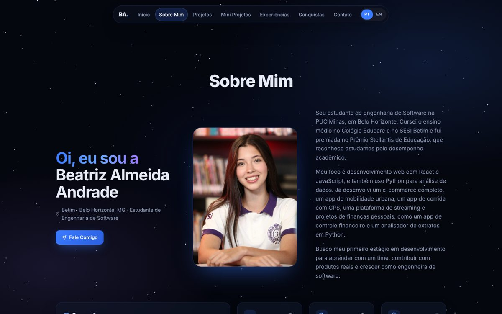 | 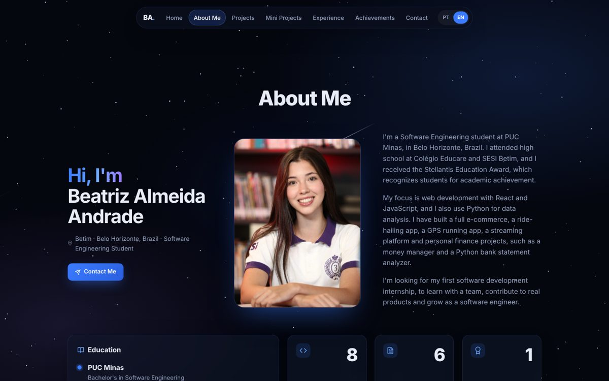 |

**Projetos:** linha do tempo com GIFs e botão "Testar aqui"

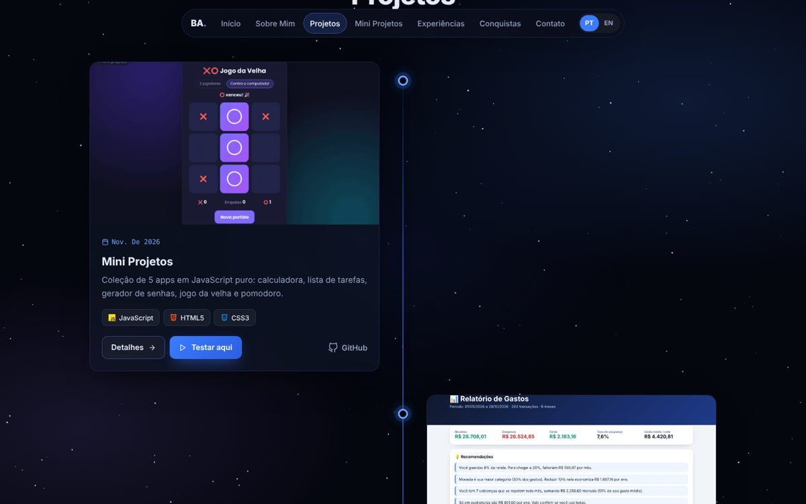

**"Testar aqui":** a loja Vitrine aberta dentro do portfólio

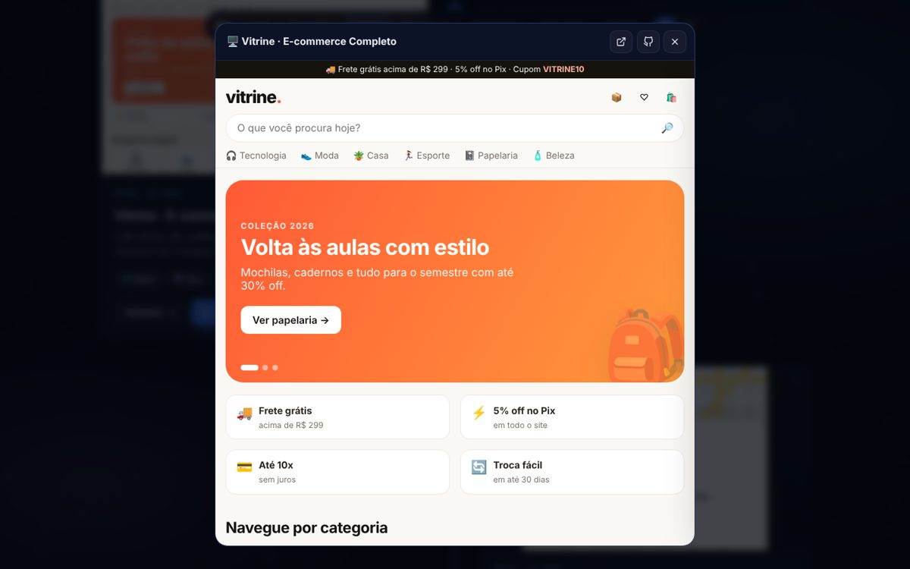

**Experiências e Conquistas**

| Experiências | Conquistas |
|---|---|
| 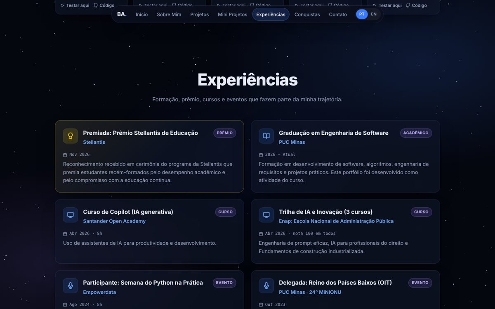 | 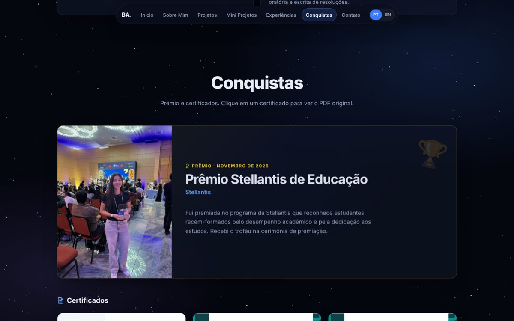 |

**Contato:** formulário com validação

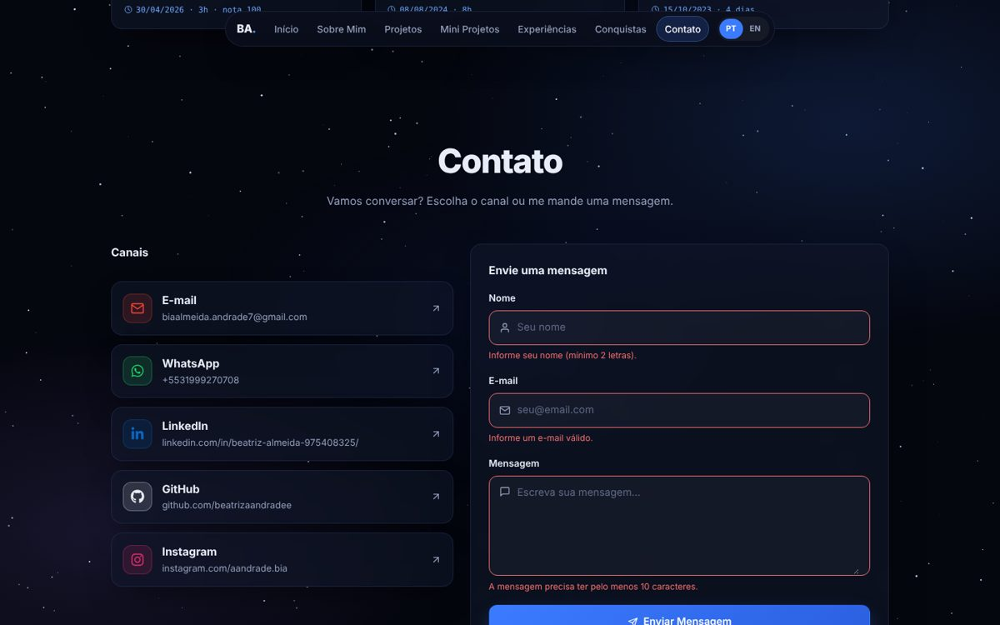

### 📱 Versão para celular

| Início | Menu | Projetos |
|---|---|---|
| 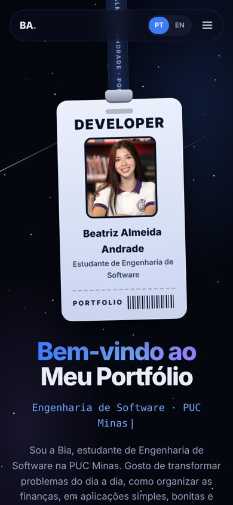 | 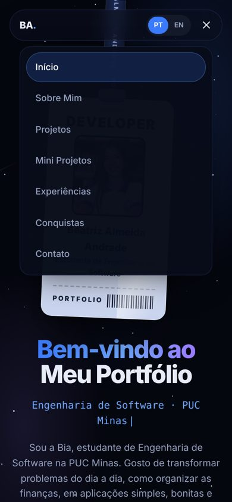 | 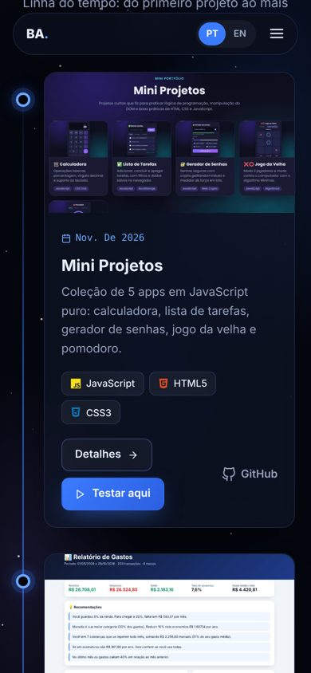 |

### 🎞️ Projetos em funcionamento

| Vitrine (e-commerce) | Lumi (streaming) |
|---|---|
| 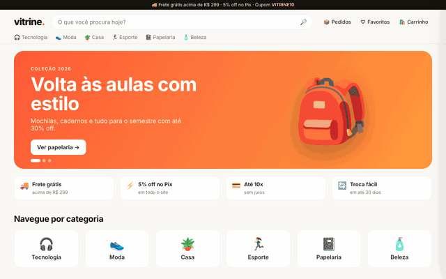 | 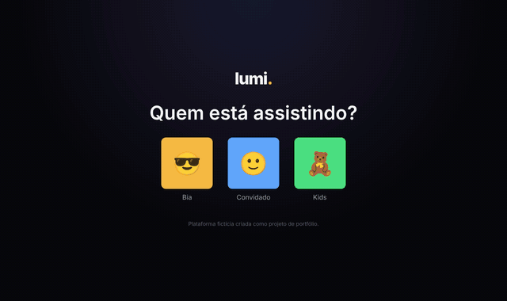 |

| Rota (mobilidade) | Ritmo (corrida) | Finanças+ |
|---|---|---|
| 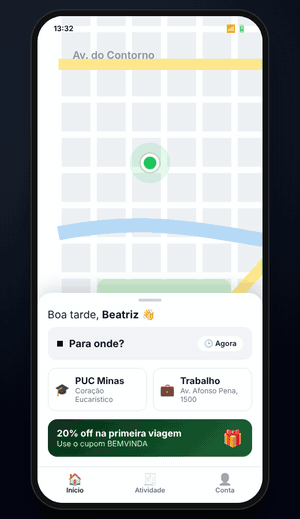 | 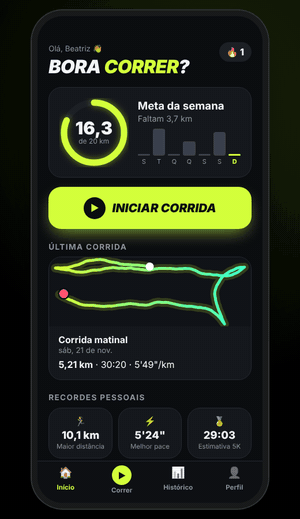 | 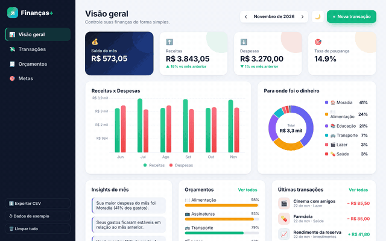 |

---

## 🧪 Testes

O portfólio foi testado **manualmente** em navegador de desktop (1440 px) e de celular (390 px):

- [x] Navegação pelo menu e destaque da seção atual
- [x] Troca de idioma PT/EN em todas as seções
- [x] Ordem da linha do tempo (do mais antigo ao mais recente)
- [x] Abertura dos GIFs, dos detalhes e do "Testar aqui" de cada projeto
- [x] Validação do formulário (nome, e-mail e mensagem) e envio do e-mail
- [x] Layout responsivo, sem rolagem lateral no celular
- [x] Build de produção sem erros (`npm run build`)

---

## 🔗 Documentações utilizadas

* [React](https://react.dev)
* [Vite](https://vite.dev)
* [React Icons](https://react-icons.github.io/react-icons/)
* [MDN Web Docs: Canvas API](https://developer.mozilla.org/pt-BR/docs/Web/API/Canvas_API)
* [MDN Web Docs: CSS Grid](https://developer.mozilla.org/pt-BR/docs/Web/CSS/CSS_grid_layout)
* [FormSubmit](https://formsubmit.co)
* [Vercel: deploy de projetos Vite](https://vercel.com/docs/frameworks/vite)
* [Figma](https://www.figma.com)

---

## 👥 Autores

| 👤 Nome | 🖼️ Foto | :octocat: GitHub | 💼 LinkedIn | 📤 E-mail |
|---|---|---|---|---|
| Beatriz Almeida Andrade |  | [beatrizaandradee](https://github.com/beatrizaandradee) | [beatriz-almeida](https://www.linkedin.com/in/beatriz-almeida-975408325/) | [biaalmeida.andrade7@gmail.com](mailto:biaalmeida.andrade7@gmail.com) |

---

## 🤝 Contribuição

1. Faça um **fork** do projeto.
2. Crie uma branch para a sua alteração: `git checkout -b feature/minha-alteracao`
3. Faça commit das mudanças: `git commit -m "feat: descreve a alteração"`
4. Envie para o seu fork: `git push origin feature/minha-alteracao`
5. Abra um **Pull Request**.

As mensagens de commit seguem o padrão [Conventional Commits](https://www.conventionalcommits.org/pt-br/v1.0.0/).

---

## 🙏 Agradecimentos

* Ao professor da disciplina de **Desenvolvimento e Integração de Aplicações Web**, pela proposta e pelos materiais de apoio.
* À **PUC Minas**, ao **SESI Betim** e ao **Colégio Educare**, pela formação.
* À **Stellantis**, pelo reconhecimento no Prêmio Stellantis de Educação.

---

## 📄 Licença

Este projeto é distribuído sob a **[Licença MIT](LICENSE)**.
